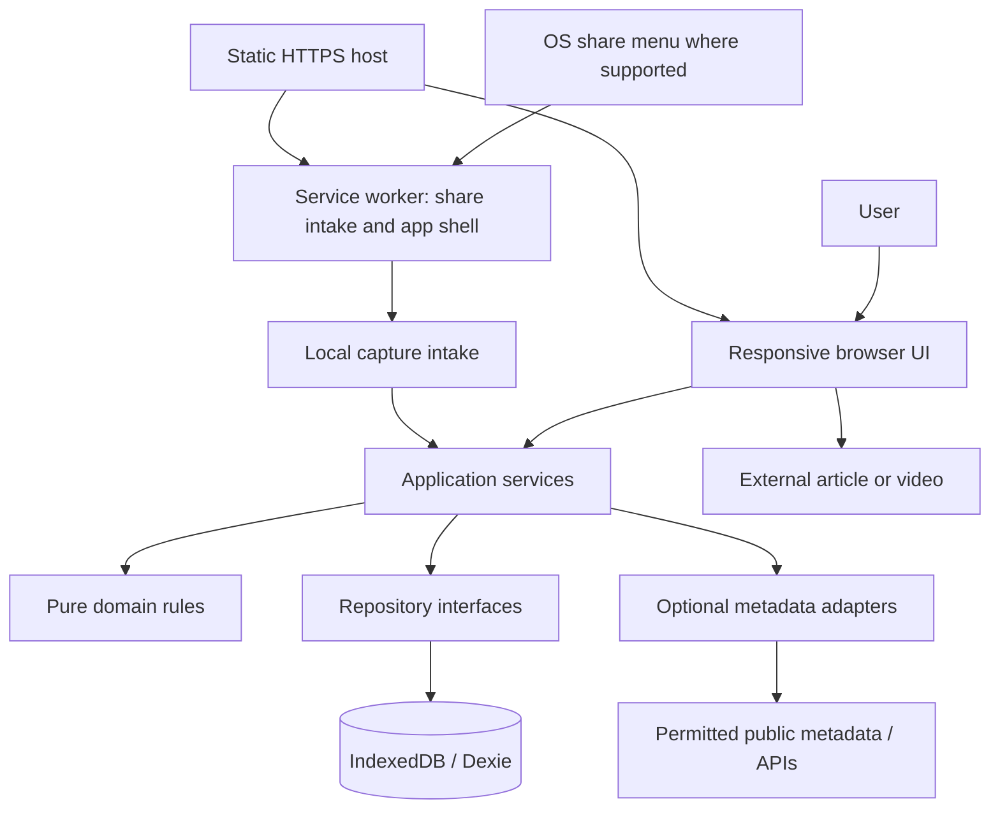

# System design

**Status:** Architecture with Milestone 1 implementation build-verified; real-browser runtime verification remains outstanding.  
**Product authority:** [PRD.md](PRD.md). Delivery scope: [MILESTONES.md](MILESTONES.md).  
**Technical choices:** [TECH_STACK.md](TECH_STACK.md).

This document explains how to implement the approved workflow. Requirement identifiers below are references, not a second acceptance checklist. Technical details are working defaults that can evolve without changing product scope.

## Architecture



The static host serves the application, not a database or URL-fetching proxy. Browser UI and service worker share the same origin's IndexedDB through a worker-safe storage module. Domain logic does not import React, Dexie, browser globals, or provider SDKs. The service worker handles durable intake and caching, not long-running metadata extraction.

## Module boundaries and source layout

```text
src/
  App.tsx, main.tsx     # Root composition and application bootstrap
  features/             # Capture, inbox, queue, learning, notes, settings UI
  domain.ts, types.ts   # Types, estimation, backlog, lifecycle rules
  application/          # Capture, commit, complete, enrich, export/import use cases
  db.ts                 # Dexie schema and migrations
  repositories/         # Dexie-backed reads, writes, and subscription hooks
  providers/            # Optional metadata adapters and result validation
  shared/               # Reusable accessible UI and formatting helpers
  sw.ts                 # Custom service worker, intake handling, precache
tests/
  e2e/                  # Production-build browser workflows
```

Use feature-local tests beside the implementation where practical. Keep database access behind repositories, including in React subscription hooks; do not scatter queries through UI components.

## Persistence model

Proposed stores below support FR-01 through FR-10 and FR-12 through FR-14. Final TypeScript and runtime schemas live with the implementation. Do not add note-link tables for deferred FR-11.

| Store                       | Key data                                                                                                                                                         | Notes                                                                                                                                     |
| --------------------------- | ---------------------------------------------------------------------------------------------------------------------------------------------------------------- | ----------------------------------------------------------------------------------------------------------------------------------------- |
| `materials`                 | UUID, original URL, normalized URL, domain, title, type, status, priority, categories, timestamps, revision                                                      | Status values map to the PRD lifecycle; index normalized URL, status, and updated time                                                    |
| `materials` duration fields | nullable content seconds, duration source, completeness, optional word count, playback-speed preference, effort multiplier, nullable manual total-effort seconds | Keep original video runtime separate from speed-adjusted consumption time; keep field provenance so refreshes cannot replace manual edits |
| `notes`                     | UUID, material ID, plain-text content, created/updated timestamps                                                                                                | Plain text is the proposed initial format; richer formatting remains an open product choice                                               |
| `settings`                  | schema-compatible singleton, nullable availability configuration, availability reminder date, reading speed, default multiplier                                  | Unset availability differs from configured zero capacity; a skipped availability prompt returns after three months                        |
| `sessions`                  | UUID, material ID, start/end timestamps, paused/elapsed timer state                                                                                              | Introduce with the optional timer; elapsed time never proves completion or automatically reduces effort                                   |
| `materialEvents`            | UUID, material ID, event type, timestamp                                                                                                                         | Minimal local lifecycle history to compute the PRD's cohort metric; no external analytics pipeline                                        |
| `captureIntake`             | UUID, parsed candidate URL/title, received timestamp, processing state                                                                                           | Durable staging for incoming shares; retain only until successfully consumed or dismissed                                                 |

Use seconds for duration/effort and UTC timestamps for persisted instants. Render minutes and local dates at the UI boundary. Reject invalid numeric values; `null` means unknown. Recompute derived effort, backlog totals, and recommendations instead of storing additional authoritative copies. Define final indexes from actual query needs.

Normalize URLs conservatively: validate HTTP(S), preserve the original, and remove only known tracking parameters. Do not strip query parameters or fragments that may identify an article, video, or section. Duplicate detection warns rather than silently discarding a user's capture.

Lifecycle mutations and associated history updates run in one transaction. Completion records an explicit completion event; archive is a separate event. Reopening clears current completed state while retaining history. Cohort reporting uses unique committed material IDs in the chosen cohort, rather than treating repeat commits or completion clicks as new materials. Deleting a material removes its related notes, sessions, and events transactionally; metrics then describe retained local records. Document this limitation in the statistics UI.

## Main flows

### Capture and enrichment — FR-02, FR-03

1. Parse and validate a pasted URL or shared URL/text. If multiple candidates exist, let the user choose rather than silently saving an arbitrary one.
2. Persist a minimal Inbox material before any network lookup; acknowledge success only after the transaction commits. Show a domain/URL placeholder when a title is unavailable.
3. Attempt optional enrichment in the foreground. A timeout, CORS rejection, offline state, unsupported URL, or provider error leaves the saved item usable and editable.
4. Validate adapter output and patch eligible fields transactionally. Re-read the current record before applying results; preserve manual provenance and overrides, and discard results for deleted items or changed source URLs.
5. A retry may be offered later. Do not rely on a browser tab or service worker remaining alive to finish enrichment.

Adapters return typed partial results with provenance/completeness plus a failure reason when appropriate. Distinguish unavailable metadata from a measured zero runtime. Do not infer full-article duration from a preview. Exact estimation and fallback behavior is defined in FR-03 and FR-04.

### Incoming shares — FR-02

Configure the manifest share target to accept title, text, and URL through a POST endpoint within the worker's scope. The service worker validates the same-origin intake route, parses shared fields, persists a small intake record using `event.waitUntil`/the response lifetime, and redirects to an app route containing only its generated intake ID. The app consumes it through the ordinary capture service.

Track consumed intake IDs so reloads cannot create duplicate saves from the same request. New independent shares still follow the normal duplicate-warning flow. If validation or storage fails, show a recoverable error rather than a false saved confirmation. On unsupported platforms, the UI presents URL paste. The static host alone cannot process POSTs; receiving shares depends on the installed worker handling that route. Initial install/setup failures must leave the normal browser workflow usable.

### Estimation and recommendations — FR-04, FR-06, FR-07

Pure functions take validated records and settings and return estimated effort with provenance, partial backlog totals, or recommendation results. The formulas and treatment of unknown values are owned by the PRD.

Use the manual total-effort override first. Otherwise calculate from the chosen content basis and preferences. Round for display at the final boundary, not repeatedly inside calculations. Until the remaining-effort question in PRD section 15 is resolved, use the fixed estimate for unfinished items; do not subtract timer time automatically or implement a manual remaining-effort feature by assumption.

A proposed deterministic ranking first selects active queue items with known effort that fits the budget, then orders by priority, in-progress status, shorter effort, and stable creation-time/ID tie-breakers. Keep ranking parameters in one domain module. Surface a no-match result separately from optional partial-session suggestions. Document intentional ranking changes with tests; they must preserve FR-07.

### Learning and completion — FR-08, FR-09

Open the source externally unless an allowed embed is available. Preserve the material-detail route for returning to the app. Marking In Progress and Complete are application commands; launching a URL does not prove the user consumed it. Completion updates material state and history in a transaction, then offers an optional takeaway. Note-save failure must allow retry without undoing or duplicating completion.

If a timer runs, persist timestamps and pause state rather than trusting a background `setInterval`. Recalculate elapsed time when the page resumes. Handle interrupted sessions without marking material complete. The Milestone 2 implementation uses a fixed optional 25-minute focus interval with start, pause, resume, and end controls; custom focus and break durations remain the open product question recorded in the PRD and are not exposed as settings.

### Notes, export/import, and migrations — FR-10, FR-13

Store notes as text with a valid material reference. Validate the entire versioned export envelope, record schemas, IDs, references, status values, URLs, and numeric bounds before modifying local data. Include material history and sessions when implemented so exported statistics and timer records can round-trip; exclude disposable capture intake and external credentials.

Recommended import strategy: additive import with an explicit conflict preview for matching IDs. Never overwrite existing records or clear the database silently. Apply the selected valid import atomically, reject unsupported future versions with a useful message, and migrate known older export formats explicitly. An interrupted import must leave the previous dataset intact.

Database migrations are versioned and transactional where IndexedDB permits. Handle multi-tab version blocking with a close/reload message. If storage fails, show an unsaved/error state and preserve editable input where possible; do not quietly switch to volatile storage while claiming durable success. Browser persistence requests are best effort, and export remains the user's backup path.

## Offline, updates, and deployment

Precache the app shell and bundled assets. Read the queue, settings, and notes from IndexedDB while offline. Do not cache third-party articles, media, or private content by default. External content still needs its source network/access permissions.

Prompt before activating an update that would reload the page; preserve in-progress edits and timer state. Keep old/new application and database versions compatible during upgrades, and test service-worker activation separately from database migrations. Clear obsolete asset caches without touching user data.

Serve the SPA over HTTPS with fallbacks for app routes; serve the worker and manifest at stable paths with appropriate update-friendly caching. Preserve the deployment origin: changing domains creates a different browser-storage boundary and needs explicit export/import guidance.

## Security and privacy boundaries

Render untrusted text as text. If rich HTML rendering is introduced later, add sanitization at that boundary. Validate external URLs and use safe link behavior. Keep raw shared message text only as long as needed to extract the selected URL; exclude notes and submitted URLs from routine logs. Metadata requests and external thumbnails reveal network information to their hosts; disclose enabled external requests and keep them optional to the core workflow. Configure a content security policy around actual enabled providers rather than permitting arbitrary script execution.

An extraction server, cloud synchronization, and native wrappers are future architecture changes. They are not needed to implement this design. Any future server fetching user URLs needs its own authentication/abuse and SSRF design; do not build it speculatively.

## Verification and unresolved choices

Implement checks alongside the relevant milestone. Use unit tests for domain rules, storage tests for transactions/migrations, and browser tests for persistence, import/export, and the primary journey. Run offline/service-worker tests against the production build. Simulated share POST handling is useful automated coverage but does not establish native share-menu availability; verify that on an actual installed device.

Product questions remain in PRD section 15 and the corresponding milestone section. No additional copy is maintained here. In particular, this design does not settle per-day scheduling, timer presets, remaining-effort controls, goals, or rich-text requirements. Selecting framework and storage defaults does not resolve those questions.
