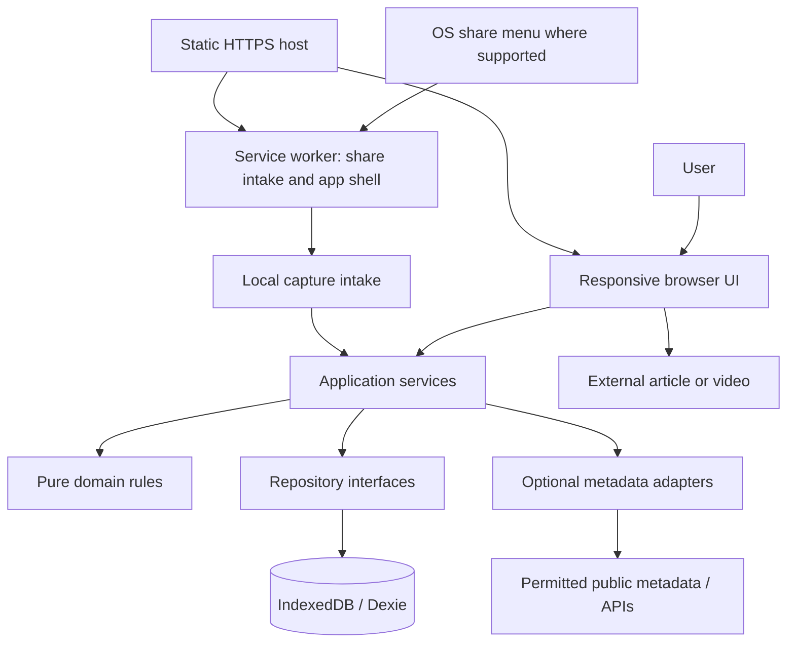

# System design

**Status:** Target architecture for PRD v2.1; simplification not implemented. The existing app includes capture, commitment, sessions, notes, and data transfer. Physical-device release validation remains outstanding.

**Product authority:** [PRD.md](PRD.md). Delivery scope: [MILESTONES.md](MILESTONES.md).

**Technical choices:** [TECH_STACK.md](TECH_STACK.md).

This document explains how to implement the approved workflow. Requirement identifiers below are references, not a second acceptance checklist. Technical details are working defaults that can evolve without changing product scope.

## Architecture



The static host serves the application, not a database or URL-fetching proxy. Browser UI and service worker share the same origin's IndexedDB through a worker-safe storage module. Domain logic does not import React, Dexie, browser globals, or provider SDKs. The service worker handles durable intake and caching, not long-running metadata extraction.

## Module boundaries and source layout

```text
src/
  App.tsx, main.tsx     # Root composition and application bootstrap
  features/             # Capture, inbox, queue, learning, notes, settings UI
  domain.ts, types.ts   # Types, estimation, backlog, lifecycle rules
  application/          # Capture, commit, complete, enrich, export/import use cases
  db.ts                 # Current Dexie schema and initialization
  repositories/         # Dexie-backed reads, writes, and subscription hooks
  providers/            # Optional metadata adapters and result validation
  shared/               # Reusable accessible UI and formatting helpers
  sw.ts                 # Custom service worker, intake handling, precache
tests/
  e2e/                  # Production-build browser workflows
```

Use feature-local tests beside the implementation where practical. Keep database access behind repositories, including in React subscription hooks; do not scatter queries through UI components.

## Persistence model

The current app uses a version-4 Dexie schema in `src/db.ts`; that is implementation history, not a compatibility constraint. Build the new schema directly for FR-01 through FR-10 and FR-12 through FR-14. For the Milestone 1 prototype replacement, types, field names, store layout, and lifecycle identifiers may change consistently without migration adapters or deprecated aliases. Later released-schema changes follow the production evolution policy below. TypeScript and runtime schemas live with the implementation. Do not add note-link tables for deferred FR-11.

| Store                       | Target data and boundary                                                                                                                                                                                                                                |
| --------------------------- | ------------------------------------------------------------------------------------------------------------------------------------------------------------------------------------------------------------------------------------------------------- |
| `materials`                 | Stable ID, original/normalized URL, domain, title, type, status, thumbnail, timestamps. No active priority field or priority-based query ordering. Use consistent lifecycle values throughout the new model.                                            |
| `materials` duration fields | Nullable source seconds, internal provenance/completeness, optional video playback-speed preference, nullable manual estimated seconds. No active multiplier. UI exposes one estimated-minutes correction; source data remains independently preserved. |
| `notes`                     | Stable IDs, material references, plain-text content, and timestamps. No prompt state or note requirement attached to completion.                                                                                                                        |
| `settings`                  | Singleton with nullable weekday/weekend minutes, onboarding dismissal, and availability reminder date. Remove the active `readingWpm` preference; automatic provider calculations use the fixed PRD assumption.                                         |
| `sessions`                  | IDs, material references, start/end timestamps, elapsed and pause state. Retain running/paused session recovery for new-format records.                                                                                                                 |
| `events`                    | Local lifecycle events. Direct Reading-plan captures must record capture and commitment atomically, without duplicate commitment history on retries.                                                                                                    |
| `captureIntake`             | Small durable incoming-share record. Stage the URL for the capture form; destination selection happens in the UI, not in the worker.                                                                                                                    |

Use seconds internally and UTC timestamps for persisted instants. Render minutes and local dates at the UI boundary. Reject invalid numeric values; `null` is unknown and zero is an explicit known value. Compute estimated time, capacity, and recommendations rather than maintaining redundant authoritative totals. Choose indexes for the new model's actual queries; no obsolete index or field needs to be retained.

### One-time pre-production schema replacement — FR-04, FR-13

The November 10 clarification authorizes a clean replacement of incompatible prototype local data only in the upcoming pre-production Milestone 1. Do not implement prototype-record conversion, prototype migration chains, deprecated prototype properties, old-prototype export readers, or compatibility shims for that cutover. Define current records and validation directly, remove obsolete fields, and update all consumers together. Reorganize modules when useful while retaining separation between domain rules, UI, repositories, providers, and the service worker.

Use a new database identity for the replacement schema as the default implementation: initialize its current schema once, and point both UI repositories and the service worker's intake storage at the same new identity. Pre-revision records are not copied or read by the new app. The old database may be removed as part of cutover if needed, but no cleanup scaffolding is required merely to keep compatibility. Document the selected identity with the implementation.

Never delete/recreate the current database on every app load or on a transient storage error. Subsequent launches reopen the new database and retain its records. Keep an explicit current export-format marker so unsupported old or future payloads can be rejected before writing. Export/import round trips support the current model only, including all notes associated with one material.

Verify first initialization, transition from a browser profile that contains old data, repeated-launch persistence, current-format import rollback/conflicts, and rejection of unsupported formats. Prototype migration fixtures and adapter tests are not deliverables. After this milestone, the replacement exception is closed; the following policy governs production evolution.

### Production schema evolution — FR-13

Keep the post-cutover database identity stable. For a released schema change, increment the Dexie schema version and use explicit transactional upgrade functions where record transformation is needed. Maintain the definitions and upgrade paths needed for supported installed versions; do not edit a released version in place, switch users to an empty database, or delete their database to avoid a failed upgrade. Dexie exposes the upgrade transaction through [`Version.upgrade()`](https://dexie.org/docs/Version/Version.upgrade%28%29).

Test upgrade paths from supported released versions using representative records, including skipped releases, manual zero/unknown estimates, multiple notes and their foreign keys, timer state, and imports. Verify transaction rollback/failure recovery and repeat opening after a successful upgrade. Surface blocked multi-tab upgrades with a close/reload message; do not reset storage. Prepare an export/backup and recovery path for risky changes. Prefer a forward repair when a destructive downgrade cannot be made safely; never claim that older code can read a newer schema without verification.

Version the export envelope independently from the database schema. Validate and convert supported released backup formats before an atomic import; reject unsupported/future formats without writes. Document supported versions and planned retirement. Use transitional read/write handling or staged field removal when mixed application versions require it, rather than keeping every deprecated field forever. Coordinate the app shell and service worker so older tabs/workers cannot corrupt newer records. Notify users of incompatible changes and provide a supported recovery/export path before retiring a released format.

The first production release establishes this compatibility baseline. No compatibility with discarded prototype formats is required, and no speculative migration or deprecation framework is needed in Milestone 1; add concrete migrations and tests when a released format actually changes.

Normalize URLs conservatively: validate HTTP(S), preserve the original, and remove only known tracking parameters. Do not strip query parameters or fragments that may identify an article, video, or section. Duplicate detection warns rather than silently discarding a user's capture.

Lifecycle mutations and associated history updates run in one transaction. Completion records an explicit completion event; archive is a separate event. Reopening clears current completed state while retaining history. Cohort reporting uses unique committed material IDs in the chosen cohort, rather than treating repeat commits or completion clicks as new materials. Deleting a material removes its related notes, sessions, and events transactionally; metrics then describe retained local records. Document this limitation in the statistics UI.

## Main flows

### Capture and enrichment — FR-02, FR-03

1. Parse and validate a pasted URL or shared URL/text. If multiple candidates exist, let the user choose rather than silently saving an arbitrary one.
2. Accept a typed destination (`inbox` or `queued`) from the capture form. Persist the minimal material plus capture history and, for `queued`, commitment history in one transaction before network lookup. Acknowledge only after commit. The duplicate-retry closure retains the destination; no background enrichment changes it. Show a domain/URL placeholder when a title is unavailable.
3. Attempt optional enrichment in the foreground. A timeout, CORS rejection, offline state, unsupported URL, or provider error leaves the saved item usable and editable.
4. Validate adapter output and patch eligible fields transactionally. Re-read the current record before applying results; preserve manual provenance and overrides, and discard results for deleted items or changed source URLs.
5. A retry may be offered later. Do not rely on a browser tab or service worker remaining alive to finish enrichment.

Adapters return typed partial results with provenance/completeness plus a failure reason when appropriate. Distinguish unavailable metadata from a measured zero runtime. Do not infer full-article duration from a preview. Exact estimation and fallback behavior is defined in FR-03 and FR-04.

### Incoming shares — FR-02

Configure the manifest share target to accept title, text, and URL through a POST endpoint within the worker's scope. The service worker validates the same-origin intake route, parses shared fields, persists a small intake record using `event.waitUntil`/the response lifetime, and redirects to an app route containing only its generated intake ID. The app loads the candidate into the ordinary capture form; the user chooses the destination and submits through the capture service. Reload/retry handling must not silently auto-commit an incoming share.

Track consumed intake IDs so reloads cannot create duplicate saves from the same request. New independent shares still follow the normal duplicate-warning flow. If validation or storage fails, show a recoverable error rather than a false saved confirmation. On unsupported platforms, the UI presents URL paste. The static host alone cannot process POSTs; receiving shares depends on the installed worker handling that route. Initial install/setup failures must leave the normal browser workflow usable.

### Estimation, capacity, and recommendations — FR-04, FR-06, FR-07

Pure functions return one estimated-time value with internal provenance, known/unknown plan totals, weekly allowance, and a single recommendation result. FR-04 owns the formulas; no UI component maintains a second calculation. Use the manual estimated-time override first, otherwise the valid source duration (adjusted only by the retained video speed preference when appropriate). Round at display boundaries and never multiply by the retired learning factor.

Keep fixed estimates until explicit completion; elapsed timer time does not reduce them. A capacity view model distinguishes empty, under-capacity, full, overflow, unknown estimates, unset allowance, and zero allowance. Return actual planned/available totals and overflow separately from a clamped visual fraction. Render an accessible meter and text in `CommitmentDashboard`; use Tailwind/native semantic HTML, not a chart dependency. The component must not treat a week boundary or completion count as a meter reset.

Recommendation ranking follows FR-07 in one domain module: filter active known estimates that fit, prefer in-progress, then shorter estimate, creation time, and stable ID. Return at most one primary item and a distinct no-match/optional partial-session result. Expose the full active collection only through manual selection. Remove priority from the type consumers, sorting, UI, and fixtures together.

### Reading and completion — FR-08, FR-09

Open externally unless an allowed embed is available; preserve the selected item for returning to the app. In Progress and finish are application commands, and opening a URL does not prove consumption. Completion updates the material and history transactionally, then refreshes the plan/recommendation selection. Remove `TakeawayPrompt` and its automatic note-creation path. Notes use their existing independent repository commands before or after completion; note failure cannot undo or duplicate a completed transaction.

Persist timer timestamps and pause state rather than trusting background intervals. Recalculate elapsed time when the page resumes; interruptions and interval expiry never complete materials. Retain the existing fixed 25-minute timer with start/pause/resume/end controls and active-session recovery. If optional controls collapse, keep the session lifecycle active independently of panel visibility; hiding a panel must not stop timer persistence or expiry handling.

### Presentation and action hierarchy — FR-06, FR-07, FR-12

Retain single-screen composition and the chosen React stack; no router or new component framework is required. Feature files and types may be reorganized or replaced as needed for the accepted behavior, while maintaining the module responsibilities above. `App.tsx` continues to own top-level dialogs and mobile header navigation. Capture gets the destination choice; the dashboard receives the capacity view model; the reading workspace shows one primary suggestion and notes on demand.

The material editor presents title, URL, and one estimated-minutes correction. Remove priority, multiplier, pasted-text, reading-speed, and provenance/completeness controls from their respective components; use a read-only presentation mapping for internal provenance labels. Advanced editing may retain type correction and video playback speed. Choose clear display labels independently of internal identifiers; update current-format serialization and consumers together when identifiers change.

Compose secondary actions using Headless UI menus/disclosures with Tailwind styles. For per-item menus, portal/anchor the panel so list overflow does not clip it. Close a menu before opening a dialog and test focus transfer/restoration. Follow FR-12 for primary actions, status selection, note menus, and the separate import-preview step. Preserve navigation, Cancel/Close, and active timer controls; do not put arbitrary fields or active timer UI inside a command menu.

### Notes and current-format export/import — FR-10, FR-13

Store notes as text with a valid material reference. Retain the existing one-to-many relationship: each note has its own primary ID and `materialId` is a non-unique index. Creating a note adds a new record; updates and deletion target the note ID rather than replacing all notes for the material. Validate the entire current-format export envelope, record schemas, IDs, references, status values, URLs, and numeric bounds before modifying local data. Include all notes, existing material history, and sessions so they can round-trip without collapsing notes by material ID; exclude disposable capture intake and external credentials.

Retain additive import with an explicit conflict preview for matching IDs. Imports must not overwrite current records or clear the database. Apply the valid current-format import atomically; reject every unsupported format, old or future, with a useful message. During Milestone 1, do not convert discarded prototype backups. After production release, convert documented supported released formats under the production evolution policy above. An interrupted or rejected import leaves the current dataset intact.

Keep current schema initialization centralized and handle blocked database opening/deletion with a close/reload message when necessary. If storage fails, show an unsaved/error state and preserve editable input where possible; do not quietly switch to volatile storage while claiming durable success. Browser persistence requests are best effort, and export remains the user's backup path.

## Offline, updates, and deployment

Precache the app shell and bundled assets. Read the queue, settings, and notes from IndexedDB while offline. Do not cache third-party articles, media, or private content by default. External content still needs its source network/access permissions. The UI explains that local browser data is not cross-device storage and makes a manual export available for backup or transfer.

Prompt before activating an update that would reload the page. At Milestone 1's pre-production cutover only, update the app shell and worker together so they use the new database identity; discarded prototype storage is outside the retention guarantee. After that cutover, use the production evolution policy for schema changes and retain the identity. Normal updates within the new model must preserve in-progress edits, timer state, and persisted records. Test worker activation and current-schema initialization separately. Clear obsolete asset caches without resetting the current database.

Serve the SPA over HTTPS with fallbacks for app routes; serve the worker and manifest at stable paths with appropriate update-friendly caching. Preserve the deployment origin: changing domains creates a different browser-storage boundary and needs explicit export/import guidance.

## Security and privacy boundaries

Render untrusted text as text. If rich HTML rendering is introduced later, add sanitization at that boundary. Validate external URLs and use safe link behavior. Keep raw shared message text only as long as needed to extract the selected URL; exclude notes and submitted URLs from routine logs. Metadata requests and external thumbnails reveal network information to their hosts; disclose enabled external requests and keep them optional to the core workflow. Configure a content security policy around actual enabled providers rather than permitting arbitrary script execution.

An extraction server, cloud synchronization, and native wrappers are future architecture changes. They are not needed to implement this design. Any future server fetching user URLs needs its own authentication/abuse and SSRF design; do not build it speculatively.

## Verification and unresolved choices

Implement checks alongside the relevant milestone. Use unit tests for domain rules, storage tests for initialization, persistence, and transactions, and browser tests for persistence, import/export, and the primary journey. Run offline/service-worker tests against the production build. Simulated share POST handling is useful automated coverage but does not establish native share-menu availability; verify that on an actual installed device.

Product decisions and remaining release choices live in PRD section 15. The new milestone cycle implements the accepted simplifications and carries forward unresolved physical-device checks. Preserve the retained timer and weekday/weekend behavior; do not reintroduce removed controls or implement deferred features during cleanup.
